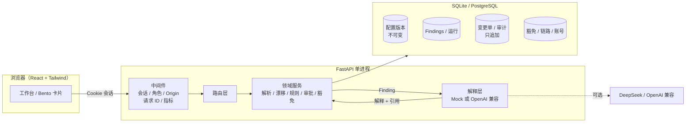
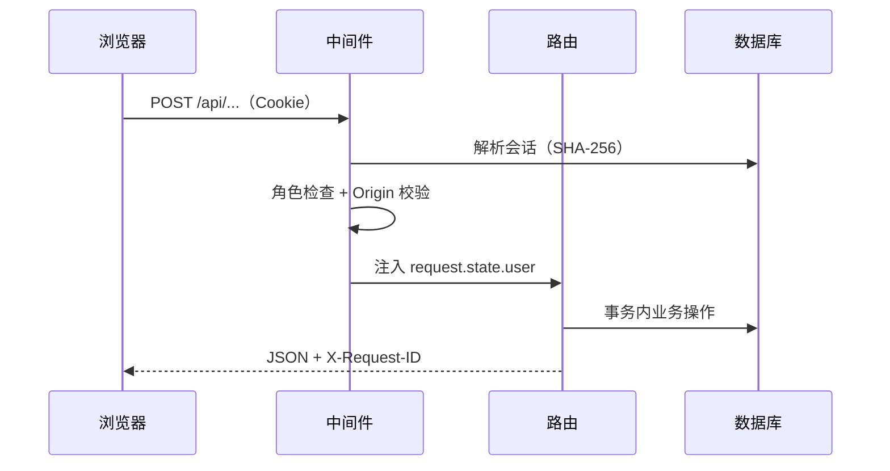

# 架构与信任边界

## 一句话

配置是证据：版本不可变，判定由确定性代码产生，模型只能解释，变更必须人工审批。

## 组件

## 一次请求的路径

## 数据与不可变性

| 表 | 约束 |
| --- | --- |
| `config_versions` | 只允许 INSERT；UPDATE/DELETE 触发器拒绝 |
| `audit_events` | 只允许 INSERT；UPDATE/DELETE/TRUNCATE 拒绝（PostgreSQL） |
| `findings` / `explanations` | 只允许 INSERT，UPDATE 拒绝 |
| `change_requests` | 证据快照不可更新；必须引用同设备、violated 的 Finding；快照条数=引用条数 |
| `baselines` | 每设备只有一个 active（部分唯一索引） |

## 判定与解释的边界

1. 规则是纯函数：输入解析后的配置，输出 `violated / satisfied / undetermined / not_applicable`
2. 未解析的 OSPF 行会让未覆盖规则变成 `undetermined`，不会被当成通过
3. 模型只能拿到一条 Finding 和它的证据，输出必须是 `{text, citations}`
4. 引用校验不通过就丢弃；模型不能改变 Finding
5. 变更单由人批准；系统从不连接设备、从不下发配置

## 部署形态

- 本地：`uvicorn` 单进程 + SQLite（WAL）
- 容器：多阶段构建（Node 构建 UI → Python 运行），非 root，启动先迁移，healthcheck 打 `/api/health`
- 单用户：本地账号 + editor/approver/admin 三种角色；无多租户
